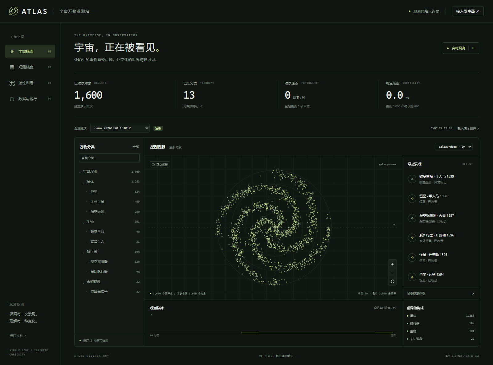

# ATLAS · 宇宙万物观测站

**所选题目：题目二：宇宙万物观测站。**

一个可运行的单机观测系统：直接接收题目发生器消息，在不断演化的分类树下组织异构对象，通过星图、对象档案、属性图谱和运行面板探索数据。每条成功确认的消息均已完整、可靠落盘；查询视图异步建立，重启后继续处理。



## 快速运行

验收目标：**Mac Docker Desktop / Linux arm64**。只有一个后台服务，无需 Node、Redis 或 PostgreSQL。

```bash
git clone https://github.com/ly726564418/project_exam.git
cd project_exam
docker compose up --build -d --wait
curl -fsS http://localhost:8000/healthz
```

打开 **http://localhost:8000**。首次启动为空世界，点击「载入演示世界」即可体验。演示使用独立 `demo-*` 批次，明确标记，不冒充官方数据。实际发生器无需转换即可 POST 到 `/ingest`。

Compose 明确使用 `linux/arm64`，后台限制合计 **4 vCPU / 4 GiB / 禁止额外 swap**；数据保存在 `atlas-data` 命名卷。持久化预算默认为 18,000 MiB，为 WAL 等留出余量。`docker compose down` 保留数据；**不要附加 `-v`，除非要删除全部观测**。

## 接入官方发生器

镜像从题目附件获取，不放入源码仓库。以下在含 `flightgen-image.tar` 的目录执行，约定来自附件《发生器操作说明》。

```bash
docker load -i flightgen-image.tar
mkdir -p generator-runs
docker run -d --name object-source \
  --platform linux/arm64 \
  --cpuset-cpus=0 --cpus=1 --memory=256m --memory-swap=256m \
  -p 127.0.0.1:9001:9001 \
  -v "$PWD/generator-runs:/runs" \
  talkingdata/flightgen:exam-v4-f1
```

点击界面右上「接入发生器」，填写新 `test_id`、速率、时长，再点击「开始观测」。也可直接控制：

```bash
curl -fsS http://127.0.0.1:9001/start \
  -H 'Content-Type: application/json' \
  -d '{"workload":"objects","target_url":"http://host.docker.internal:8000/ingest","test_id":"acceptance-001","seed":42,"batch_size":100,"workers":4,"objects_per_second":1000,"rate_profile":"bursty","ramp_seconds":2,"duration_seconds":60,"max_batches":20000,"retries":2,"objects":{"scenario":"evolving","tree_every_batches":10}}'

curl -fsS http://127.0.0.1:9001/status
# 等外层 state 为 finished 才能取得完整凭据。
curl -fsS http://127.0.0.1:9001/receipt -o acceptance-001-receipt.json
```

每轮使用新的 `test_id`。速率 0 表示尽力发送，不是暂停，启动时应同时设置 `ramp_seconds: 0`；界面会自动处理。停止：`curl -fsS -X POST http://127.0.0.1:9001/stop`，返回 202 后仍需等待 `finished`。发生器单独计入 **1 vCPU / 256 MiB**。

Mac 使用 Docker Desktop 的 `host.docker.internal`。Linux 宿主机访问由 Compose 的 `host-gateway` 配置提供；单独运行发生器时也需根据环境设置该映射。可通过 `ATLAS_GENERATOR_URL` 更改系统控制发生器的地址。

## 使用说明

1. **宇宙探索**：选择批次、分类、参考系查看 XY 正交投影。滚轮缩放、拖动平移、点击采样点查看档案。无坐标对象仍保留在档案中。星图显示采样量，默认最多绘制最近 2,500 条匹配观测；API 上限 5,000。
2. **万物分类**：显示分类及全部子分类对象数，支持名称查找、子树筛选、点击箭头收起分支。新增、改名和迁移自动反映；运行页面可追溯变更。
3. **观测档案**：按名称/ID、分类子树和异常标记筛选，游标翻页。属性筛选支持 `mass_solar`、`orbit.altitude_km` 等路径、文本相等与数值区间。数值比较只接受 JSON 数字，不静默转换字符串。
4. **对象详情**：完整异构属性、嵌套数组和对象、明确的 `null` / `false`；当前分类与观测时分类并列；可查看消息指纹、下载原始字节。
5. **属性图谱**：从真实对象发现路径、类型与出现次数。同一路径的数字、字符串、空值分别保留，提示类型变化。
6. **数据与运行**：查看可靠接收、去重、待办、隔离消息、无效对象、冲突、存储、分类演化及原始来源。

实时刷新间隔 3 秒；页面隐藏时暂停请求。「暂停刷新」只冻结界面，不停止接收。对象/分类数属于当前批次；吞吐、ACK 延迟和质量计数采用全站口径。界面无需外部 CDN，支持 390px 手机宽度及键盘操作。

## 本地开发与测试

Python **3.11+**，容器使用 3.12；SQLite 来自标准库。运行依赖和开发工具分别位于 `requirements.txt` / `requirements-dev.txt`。

```bash
python -m venv .venv
source .venv/bin/activate
# PowerShell: .\.venv\Scripts\Activate.ps1
python -m pip install -r requirements-dev.txt
python -m uvicorn observatory.app:app --host 0.0.0.0 --port 8000 --workers 1 --limit-concurrency 256 --no-access-log
```

默认数据库 `data/atlas.sqlite`，可通过 `ATLAS_DB` 修改。必须只运行一个应用进程，不能设置多个 Uvicorn worker。

```bash
python -m pytest -q
node --check web/app.js  # 可选的开发语法检查，运行无需 Node
python scripts/browser_check.py  # 本机需已安装 Microsoft Edge
python scripts/generator_run.py --rate 1000 --seconds 20 --id my-new-run
```

压测脚本保存官方 receipt、系统指标和查询延迟。接口文档：**http://localhost:8000/docs**。协议发现、数据模型、API 和校对操作见 [docs/architecture.md](docs/architecture.md)。

## 复现与验收

1. 从干净卷启动，检查 `/healthz`；加载演示，检查星图、分类、搜索、详情与手机布局。
2. 启动附件发生器并接入；等待 `finished`，保存官方 receipt，检查常规批次确认、故障注入与分类修订。
3. 等 `/api/stats` 的 `statuses.pending` 为 0；检查分类改名/迁移、观测时路径、隔离区、类型变化及原文。
4. 对同一原始消息重复 POST，确认 `duplicate=true`、同一个 `receipt_id`、对象数不增加。
5. 运行中强杀系统容器再启动；等待待办恢复，确认已接收原文和对象仍在。健康检查识别写入器故障。
6. 用 `scripts/verify_run.py` 校对官方 ACK bitmap、原文 SHA-256、有效对象内容和物化对象数。容器内操作见架构文档。

## 实际测试结果

测试日期 **2026-10-28**。开发机为 Windows / WSL2 / x86_64；ARM64 容器通过 Docker Desktop 架构仿真运行，**不宣称 Mac 原生实测**。受限容器与 Windows 原生结果分开记录。原始结果位于 [docs/results/](docs/results/)。

| 测试 | 结果 |
| --- | --- |
| 自动化正确性 | 13 项通过：持久化、并发去重、分类乱序/历史/迁移、毒消息、冲突、类型筛选、游标、参考系、跨批次隔离、恢复、边界、隔离批次可见性 |
| 浏览器端到端 | Edge headless，1600×1100 / 390×844，13 项检查通过，含本地接口文档，0 脚本错误，无手机横向溢出 |
| Windows 原生，官方发生器，目标 1,000 对象/秒，15 秒 | 确认常规对象 10,100；注入额外有效对象 198、无效对象 2；4 次重复包去重；无重试/超时；并行档案查询 P95 41.53 ms |
| 受限 ARM64 仿真容器，目标 5,000 对象/秒，30 秒 | 常规确认 13,500，即实测约 450 对象/秒；查询 P95 331.88 ms；采样内存最高 166.7 MiB；无超时、重试或 5xx；结束时 4 个请求响应被发生器中断，接收端仍完整保存 |
| 受限 ARM64，独立饱和复测，30 秒，batch=200、workers=8 | 常规 52,000 对象全部确认，原文确认约 1,733/s；查询 P95 365.02 ms；采样内存最高 284.9 MiB；停止发送后另用约 75 秒物化完积压。不是可持续物化吞吐 |
| 强杀恢复 | 在 6 条消息已确认时 SIGKILL；18 条请求中断；重启后重放全部 24 条消息，2,400 对象完整、无重复计数；已确认 receipt 和所有原始字节逐条校对通过 |

受限容器中累计收录 **136,090** 个有效对象，数据库、WAL 等占用约 **307.5 MiB**。分类历史与原文均保留。完整测试条件、运行终止时的树消息取消和诊断轮次的干扰说明见 [结果索引](docs/results/README.md)。饱和复测与对象/分类内容校对均提供原始文件。

`objects_per_second` 是目标值，bursty 波动、爬坡和发生器性能均影响实际吞吐，不能将目标值当作实测结果。额外注入批次不计入发生器 `acknowledged_objects`，系统有效对象数可能高于该数。无效消息的 202 表示原文完整保存，不代表业务校验通过。

## 关键取舍与已知限制

- **可靠性**：SQLite WAL + `synchronous=FULL`，单写入器、短事务、最多 32 请求组提交，提交后返回 202。压缩原文与异步视图分离，超时重试不重复收录。
- **预算**：32 MiB SQLite 缓存、128 条写入等待队列、2 MiB 单消息、256 HTTP 并发上限。队列满 429，磁盘预算拒绝 507；写失败不返回成功。主数据库有硬上限，为 WAL 留出空间。
- **未知结构**：完整 JSON 与原类型保留，只索引常用元数据、类型和参考系。结构统计展开对象嵌套至三层，数组保留为数组，完整内容随时可读。
- **可视化**：不同参考系/单位绝不混画，不编造全局坐标转换。星图为最近对象的有界采样，不代表全量密度，不是 3D 物理仿真。
- **查询**：游标分页、增量计数。名称子串与任意属性未做全字段索引，可能扫描；约 2 秒超时要求缩小范围。未完成千万级对象或长期稳定性测试。
- **一致性**：ACK 表示原文持久化，物化最终一致；大突发可积压。跨 API 不共享快照，快速增长时计数可能相差一次刷新。历史分类名称可重建，历史对象总量不作伪装。
- **冲突**：同 ID 同内容幂等；不同内容保留第一份有效观测并记录冲突，不猜测更新语义。未来的更新/删除协议需显式扩展。
- **保留策略**：原文不自动删除，20 GiB 不能无限收录。极端积压可能需要额外物化空间，接近容量时应停止发生器并迁移/导出；未实现不停机归档。
- **部署范围**：本地单用户验收系统，无登录、TLS、多机复制或高可用；应仅对可信本机网络开放。进程强杀恢复不等于真实断电测试；未测试宿主磁盘损坏。

## 目录

```text
observatory/            HTTP API、持久化、恢复、投影、独立演示
web/                    HTML / CSS / Canvas / JavaScript，无需构建
tests/                  正确性、幂等、历史、隔离、恢复、边界测试
scripts/                官方发生器压测、凭据校对、浏览器检查
docs/architecture.md    协议发现、API、数据模型、可靠性与运维
docs/results/           测试摘要、官方 receipt、校对结果
docs/screenshots/       实际浏览器截图
Dockerfile              非 root ARM64 Linux 容器
compose.yaml            资源限制、健康检查、持久化卷
```

## 提交

```text
所选题目：题目二
仓库链接：https://github.com/ly726564418/project_exam
最终 commit SHA：提交时 git rev-parse HEAD 的完整输出
运行与验收的详细说明：README.md
```

正式交卷前确认最终提交已推送到 `main`。平台「保存仓库链接」和「交卷」是独立操作，最终以平台成功记录的 SHA 为准。
