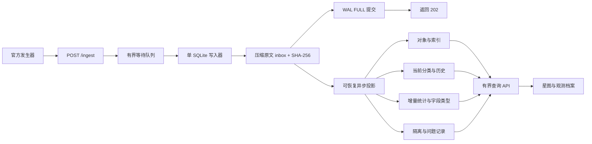

# 设计与接入记录

## 协议发现

先通过独立 HTTP 捕获端可靠记录题目镜像的真实消息，再分别运行短时 evolving 和故障注入场景。未依赖预先给定 schema，未读取发生器内部实现。

镜像 `talkingdata/flightgen:exam-v4-f1`，Linux arm64。附件 tar 的题面 SHA-256：`282dad9d5d847aac0b26de6aa8391da01aff9701b922e6510731a915833d87a5`。

分类消息：

```json
{"kind":"types","test_id":"run-001","revision":1,"changes":[{"op":"create","node":{"type_id":1,"parent_id":0,"name":"万物"}},{"op":"create","node":{"type_id":10,"parent_id":1,"name":"星体"}}]}
```

后续 `op` 包括 `rename`、`move`，节点包含完整 ID、父级和名称。保存每个类型每次修订；晚到旧修订不覆盖新状态。

对象批次：

```json
{"kind":"objects","test_id":"run-001","batch_id":0,"tree_revision":1,"objects":[{"id":"run-001-0","sequence":0,"type_id":10,"name":"恒星 #0","timestamp_ms":1792627199784,"position":{"frame_id":"galaxy-1","frame_kind":"galactic","unit":"ly","x":8010,"y":-7150,"z":-200},"attributes":{"body_kind":"star","mass_solar":2.36,"source":"华东观测站","reviewer":null,"tags":["remote","夜间"]}}]}
```

观察到位置可为 null；参考系有 galactic/ly、stellar_system/km、local_surface/m。属性包含 Unicode、换行、反斜线、布尔、空值、数组与嵌套对象，同一路径可改变类型。故障注入额外发送重复包及带无效/缺失字段对象的独立批次。

## 架构与数据模型



一个进程、一个写入线程；只读查询使用独立连接。WAL 隔离读写，约 2 秒 progress handler 防止无索引查询长时间占用 CPU。`type_counts`、`frames`、`runs` 增量计数，仪表盘无需反复扫描全量对象。

`inbox.digest` 唯一，zlib 压缩原文可无损恢复；同时保存接收时间与 Flightgen 请求头。只有 FULL 事务提交之后才 ACK，进入内存队列不算成功。返回包含 `receipt_id`、`sha256`、`duplicate`、`durable`。重复请求返回首次持久化记录的 ID。

投影、插入对象、更新计数、标记 inbox 已处理在同一事务。原文提交后崩溃则重启扫描 pending；投影中崩溃则事务回滚，重做不重复计数。写入器不可用时健康检查 503，不继续发送成功确认。

202 表示**整条原消息可靠保存**，不等于所有业务字段有效。坏 JSON 和未知消息整体隔离；坏对象记录 issues，其余合法对象照常收录。所有失败内容有原文，不因一个毒对象反复重试整包。

不同 `run` 完全隔离；对象 `(run,id)` 幂等，冲突保留第一份有效观测。规范化 JSON 对象比较忽略字段排列，保留 JSON 类型。`type_history` 保存每个类型每次变更，当前状态只接受较新修订。对象保存 `tree_revision`，档案查询每个类型在该修订及之前的最新版本，避免用今天的名字替换过去的分类。

## 资源与容量边界

- 单 body 2 MiB，流式读取也检查，缺少 Content-Length 不会无限累加。
- 等待队列 128，Uvicorn 并发 256。满载返回 429/503，调用者重试。
- 一次最多 32 请求组提交，每轮最多处理 8 条持久化待办，兼顾接收与物化。
- 延迟只保留 1,000 次，趋势只保留约 90 秒，SQLite page cache 32 MiB。
- 接入前检查数据库/WAL 当前大小及新消息余量；`max_page_count` 限制主数据库，为 WAL 留出至少 128 MiB。容量不足不 ACK。
- 数据库页数上限不是文件系统配额。极端积压可能耗尽物化余量，但已 ACK 原文保留；应停止发送、保留卷、迁移或导出。未实现自动删除与不停机归档。

## API

| 接口 | 用途 |
| --- | --- |
| `POST /ingest` | 原文接收；202 持久化成功；429 背压；413 超限；507 容量不足 |
| `GET /healthz` | 写入器存活，失败 503 |
| `GET /api/stats` | 批次、持久化、队列、延迟、有限趋势 |
| `GET /api/types?run=...&revision=...` | 当前或历史分类、最近 80 条变更 |
| `GET /api/objects?run=...&type_id=...&q=...&limit=50&cursor=...` | 子树筛选、名称/ID、游标、异常、属性条件 |
| `GET /api/objects/{id}?run=...` | 完整对象、历史分类、来源凭据 |
| `GET /api/frames?run=...` | 参考系、单位、增量数量 |
| `GET /api/map?run=...&frame=...&limit=2500` | 单参考系与单位的有界样本 |
| `GET /api/fields?run=...&type_id=...` | 属性路径/类型统计，最多 600 组合 |
| `GET /api/quality?run=...` | 隔离消息、坏对象、最近接入 |
| `GET /api/receipts/{id}` | 原文、元数据，`?raw=true` 下载字节 |
| `POST /api/demo` | 独立演示批次 |
| `/api/generator/{action}` | 固定发生器上游的 status/start/stop/rate/receipt 控制 |

完整参数由 `/docs` 的 OpenAPI 展示。SQL 参数绑定，属性路径另外检查字符与层级。控制代理的基础上游地址来自环境变量，不允许客户端提交任意代理地址。

## 校对官方凭据

```bash
# 本地数据库
python scripts/verify_run.py --db data/atlas.sqlite --receipt docs/results/your-run-receipt.json

# Compose 容器；替换 receipt 名称
docker compose cp scripts/verify_run.py atlas:/tmp/verify_run.py
docker compose cp docs/results/your-run-receipt.json atlas:/tmp/receipt.json
docker compose exec -e PYTHONPATH=/app atlas python /tmp/verify_run.py --db /data/atlas.sqlite --receipt /tmp/receipt.json
```

脚本逐条验证原文 SHA-256、合法对象内容、有效唯一对象数、常规 ACK bitmap 对应对象是否全部存在、已确认分类修订是否齐全、类型历史与当前名称/父级是否符合原文、待办是否排空。额外故障注入对象与常规 ACK 对象分开计量。

## 备份与运维

通过 `sqlite3.Connection.backup()` 做在线一致性备份，或先停系统再备份完整卷。**运行中只复制 `.sqlite` 可能遗漏 WAL，不能作为可靠备份。** 停发生器后等 pending=0，再 `docker compose stop`。

提供 `python scripts/backup.py --db data/atlas.sqlite --output data/backup-new.sqlite`，不会覆盖已有目标，完成后执行 SQLite quick_check。容器内可将脚本复制到 `/tmp` 后运行，输出到持久化卷，再 `docker compose cp` 导出。

容量不足、数据库损坏或写入器停止时，先停止发生器，保留卷、日志、原文与 receipt；不要删除数据或忽略错误继续确认。进程恢复测试不等于断电测试，未声称抵抗宿主存储损坏。
